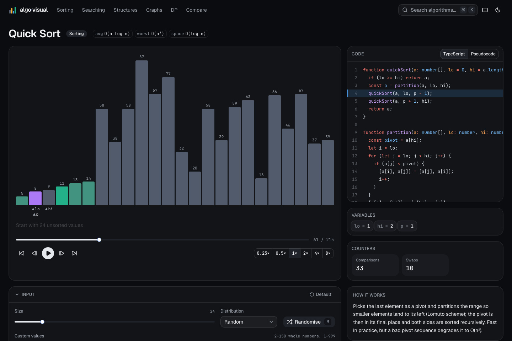
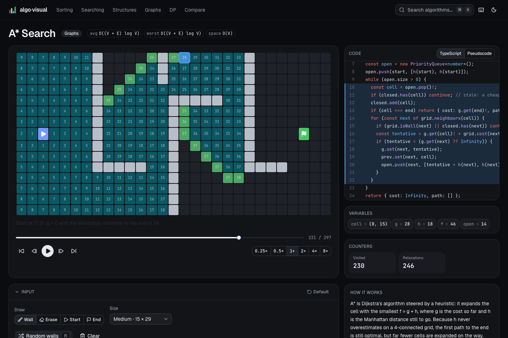
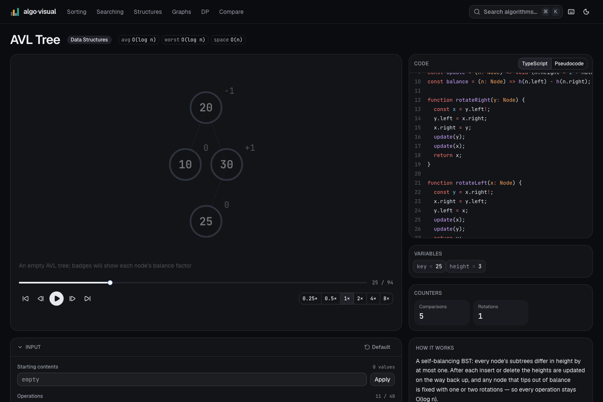
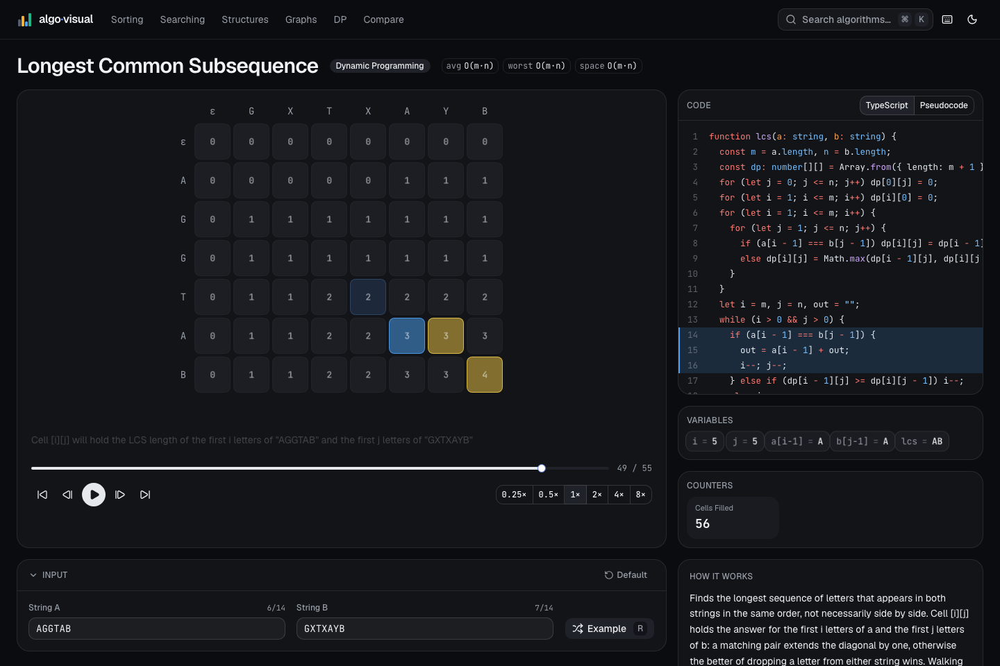
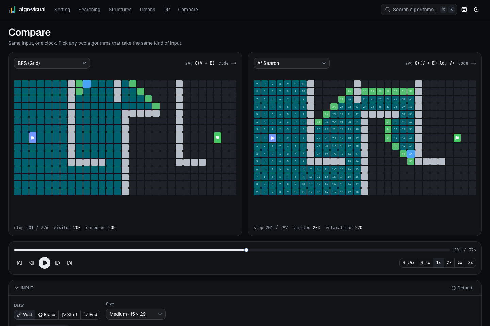

# algo·visual

[](LICENSE)
[](https://algo-visual-iota.vercel.app)

An interactive visualizer for data structures and algorithms, made so students can watch each step happen and change the input themselves. Every algorithm plays as an animation you can pause, rewind and scrub, with the real source code highlighted line by line.

**Try it: [algo-visual-iota.vercel.app](https://algo-visual-iota.vercel.app)**



## Why this exists

Most people meet algorithms as pseudocode next to a diagram frozen at one moment. What happens between one line and the next is left to the imagination. algo·visual shows that part: every comparison, swap, pointer change and table cell is a step you can pause on, rewind or replay. It's meant for students, whether you're seeing this material for the first time or revising for an exam or interview. Teachers can put it on a projector too.

| | |
|---|---|
|  |  |
|  |  |

## What's inside

36 algorithms across five categories. Each one has a step-by-step trace, its source and pseudocode highlighted line by line, live variables, counters, an input editor and a shareable URL.

| Category | Algorithms |
|---|---|
| Sorting | bubble, selection, insertion, shell, merge (bottom-up, aux buffer), quick (Lomuto), heap, counting, radix |
| Searching | linear, binary, jump |
| Data structures | dynamic array, singly and doubly linked list, stack, queue, hash table (chaining), BST, AVL (named rotations), min-heap, trie |
| Graphs | BFS and DFS (grid and graph), Dijkstra (weighted grid and graph), A*, topological sort (Kahn), Prim, Kruskal (union-find table) |
| Dynamic programming | Fibonacci, longest common subsequence, 0/1 knapsack, edit distance |

Other things you can do:

- Run two algorithms side by side on the same input with one shared clock (`/compare`).
- Type your own values, build a list of operations, or draw walls and weights on a grid.
- Share exactly what you are looking at. The URL stores the input and the current step.
- Search every algorithm with ⌘K, and press `?` for the keyboard shortcuts.
- Use it in light or dark mode, from the keyboard, with reduced motion respected.

### Keyboard

| Key | Action |
|---|---|
| `Space` | play / pause |
| `→` / `←` | step forward / back |
| `Home` / `End` | first / last step |
| `1` to `6` | speed 0.25× … 8× |
| `R` | randomise the input |
| `⌘K` | search |
| `?` | shortcuts |

## Get involved

algo·visual is open source and built for learners, so ideas from students and teachers are the most useful kind of help. You don't need to write code to contribute.

- Missing an algorithm? [Request one](../../issues/new?template=new-algorithm.yml) and describe what you'd like to see happen on screen.
- Have an idea? [Suggest a feature](../../issues/new?template=feature-request.yml), big or small. A clearer explanation counts.
- Something looks wrong? [Report a bug](../../issues/new?template=bug-report.yml) and paste the page URL. It records the exact input and step, so the problem is easy to reproduce.
- Want to build it yourself? Pull requests are welcome. Read [CONTRIBUTING.md](CONTRIBUTING.md) first, and open an issue before starting anything large so we can agree on the approach.

Browse the [open issues](../../issues) to see what's already planned, and add a thumbs-up reaction to the ones you want most.

## Running it locally

You need Node.js 20.9 or newer and pnpm (`corepack enable` will set up the version this repo pins).

```bash
git clone https://github.com/ImranSefat/algo-visual.git
cd algo-visual
pnpm install
pnpm dev        # http://localhost:3000
```

Other scripts:

```bash
pnpm test       # Vitest: invariants and correctness for every algorithm
pnpm lint
pnpm build      # every route is prerendered as static HTML
```

## How it works

Each algorithm is a plain TypeScript generator. It runs once and yields a snapshot at every interesting moment: the data, what is highlighted, the current line of code, the live variables and a one-sentence explanation. Those snapshots form a timeline, so play, pause, rewind and compare mode only change which snapshot is on screen. Renderers draw one snapshot at a time, and because every element keeps a stable id, moving between snapshots becomes a spring animation.

```
src/algorithms/**            Pure TypeScript. No React, no DOM. Generators yield Step<S>.
        │ runAlgorithm(algo, spec) → Step[]   (run once per input change)
src/store/playback.ts        zustand: steps, index, playing, speed (setTimeout clock)
src/store/input.ts           zustand: the input spec; changes re-run the generator
        │ steps[index]
src/components/renderers/**  Pure functions of a Step; motion animates between steps
src/components/code/**       Shiki (server only) and a single sliding highlight bar
```

- `src/algorithms/core` holds the types (`types.ts`), the step tracer (`step.ts`), the state shape each renderer reads (`states.ts`), input specs, validation and seeded random inputs.
- `src/algorithms/registry.ts` is the single list of algorithms. The landing page, the ⌘K search, the static routes and the OG images all read from it.
- There are 11 renderers: `ArrayBars`, `ArrayBarsAux`, `Heap`, `LinkedList`, `Stack`, `Queue`, `HashTable`, `Tree` (d3-hierarchy), `GridGraph` (editable), `NodeGraph` (d3-force) and `DPTable`.
- `/[category]/[slug]` is one static route that renders all 36 algorithm pages. URL state is read on the client.

[CONTRIBUTING.md](CONTRIBUTING.md) walks through adding an algorithm or a renderer.

### Design decisions

- Cache Components is off in `next.config.ts`. Every page is fully static and all URL state lives on the client.
- `snapshot()` shares frozen items instead of cloning them. Items are `Object.freeze`d when created, so sharing them between steps is safe. A 150-element bubble sort produces about 17k steps, and cloning every item in every step would cost roughly 150 MB.
- Colour changes use CSS transitions rather than motion values. They follow theme switches instantly and cost nothing per frame, while motion handles layout and enter/exit.
- Animation durations follow the clock, `min(0.35s, 80% of one tick)`, so 8× playback never lags behind.
- The graph and grid display code calls small named helpers (`grid.neighbours`, `PriorityQueue`) instead of inlining them, to keep the highlighted source readable.

## Built with

Next.js 16 (App Router, Turbopack, React Compiler), React 19, TypeScript, Tailwind CSS 4 with shadcn/ui and Radix, Motion, Zustand, nuqs, Shiki, d3-hierarchy, d3-force and Vitest. The site's [About page](https://algo-visual-iota.vercel.app/about#credits) credits every project it uses, with licenses, along with the visualizers that inspired it: [Algorithm Visualizer](https://github.com/algorithm-visualizer/algorithm-visualizer), [VisuAlgo](https://visualgo.net) and David Galles's [Data Structure Visualizations](https://www.cs.usfca.edu/~galles/visualization/Algorithms.html).

## License

[MIT](LICENSE) © 2026 Imran Sefat. You can use, change and share the code freely, including commercially, as long as the license notice stays with it. The GitHub and LinkedIn marks used on the site belong to their owners.

## Author

Made by [Imran Sefat](https://imransefat.com/). Find me on [LinkedIn](https://www.linkedin.com/in/imransefat/) and [GitHub](https://github.com/ImranSefat).
