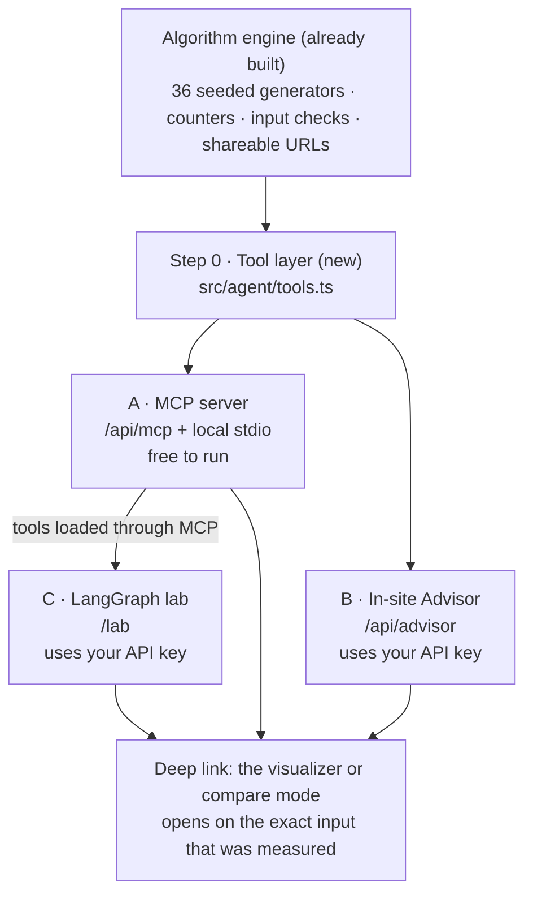

# AI integration plan

**Status:** Step 0 is being built in `src/agent/` (its README says what works and what is next). Phases A to D are
not started; the [decisions](#decisions-needed-before-any-code) at the end are still open.
**Date:** 3 November 2026

## The pitch

**The agent never guesses a Big O. It runs the experiment.**

Ask most AI assistants "which sort should I use?" and they answer from memory. On algo·visual, an agent can work out
what your data looks like, run the candidate algorithms on the site's real engine, compare the measured counts, and
hand back a link that plays the exact run in the visualizer. Every claim can be checked.

## Why this codebase is a good fit

The engine already has what agent tools need:

- **36 algorithms in 5 categories:** 9 sorting, 3 searching, 10 data structures, 10 graphs, 4 dynamic programming.
- **Deterministic runs:** every algorithm is a seeded generator, so the same input always gives the same steps and counts.
- **Live counters:** each algorithm counts its own work (comparisons, swaps, probes, relaxations and so on).
- **Input checking:** `sanitizeSpec`, `LIMITS` and `MAX_STEPS` (60,000) in `src/algorithms/core/` already guard every input.
- **Shareable URLs for every input** (`src/lib/url-state.ts`):
  - Array inputs: `/sorting/quick-sort?n=24&seed=7&dist=reversed`
  - Custom values: `/sorting/quick-sort?dist=custom&custom=5,3,8,1`
  - Search target: `/searching/binary-search?n=40&seed=3&target=42`
  - Every other input kind: `?in=<json spec>`
  - Compare mode: `/compare?a=quick-sort&b=merge-sort&n=50&seed=7&dist=reversed`
  - A specific step: add `&step=120`
- **Growth measurement:** `measureGrowth` in `src/lib/growth.ts` (from PR #6) already runs an algorithm across sizes and
  input kinds.

## Architecture

One tool layer, three ways to use it.



| Part | Who uses it | Who pays for the AI |
| --- | --- | --- |
| A · MCP server | People using Claude Code, Claude Desktop, Cursor or any other MCP client | The user's own AI client (free for you to run) |
| B · Advisor | Visitors to the site | You (your Anthropic API key) |
| C · LangGraph lab | Visitors to the `/lab` showcase page | You (your Anthropic API key) |

## Step 0: the shared tool layer

Plain TypeScript with zod schemas in `src/agent/tools.ts`. No React and no AI library, so it's easy to test, and it's the
only code that touches the registry. Everything else calls these tools.

| Tool | Takes | Returns |
| --- | --- | --- |
| `list_algorithms` | optional category | slug, name, input kind, complexity (best, average, worst, space), stable, in place, counter names |
| `get_algorithm` | slug, optional `include` | description and complexity; source, pseudocode or Python on request |
| `run_algorithm` | slug, input | output, final counters, step count, a few step notes, deep link |
| `compare_algorithms` | list of slugs, input | counters side by side, `/compare` links for each pair |
| `profile_input` | list of values | size, how sorted it is (inversion ratio), share of duplicates, value range |
| `measure_growth` | slug, optional sizes and input kinds | counters at each size for each input kind |
| `make_link` | slug (or two for compare), input, optional step | a URL that plays that run |

**Where it stands (10 November 2026):** the folder exists with the shared pieces (`tool.ts`, `schemas.ts`, `input.ts`,
`links.ts`, `limits.ts`, `counters.ts`) and two working tools, `run_algorithm` and `make_link`. `list_algorithms`,
`get_algorithm` and `profile_input` have their schema and description and a `TODO` body, so they are good first tools.
`compare_algorithms` and `measure_growth` come after those. `pnpm agent` tries any tool from the terminal, and
`src/agent/README.md` has the details.

Tasks:

- [x] `run_algorithm` runs the generator to the end without keeping every step (`runToEnd` in `registry.ts`, which
      `growth.ts` now uses too), so memory stays flat.
- [ ] Generalise `measureGrowth` beyond Quick Sort (array inputs only).
- [x] Limits: reuse `LIMITS` and `MAX_STEPS`. Experiments may go past the animation's 150 elements (no animation is
      needed), up to a hard cap and a time budget per call (`EXPERIMENT` in `src/agent/limits.ts`).
- [x] Tests (Vitest): schemas, limits, and every deep link round-trips through `specFromQuery`.

### Watch out: counters aren't comparable across algorithms

Each algorithm counts different things, even within a category:

| Category | Counters in use |
| --- | --- |
| Sorting | comparisons + swaps, comparisons + shifts, comparisons + writes, passes + writes, reads + writes |
| Searching | comparisons |
| Data structures | comparisons + rotations, hops + relinks, probes + collisions, pushes + pops, enqueues + dequeues, shifts + resizes, nodes created + steps |
| Graphs | visited + edges considered, visited + relaxations, edges considered + unions, edges considered + key updates, and others |
| Dynamic programming | cells filled |

So the tools return the raw counters plus the step count, and the tool descriptions tell the model not to compare
counters that measure different things (for example Counting Sort's reads and writes against Merge Sort's comparisons).

## Phase A: MCP server (the headline)

Free for you to run, because the user's own AI client does the thinking. Best demo for the effort.

- [ ] Read the Next 16 route-handler docs in `node_modules/next/dist/docs/01-app/01-getting-started/15-route-handlers.md` first.
- [ ] Remote server: Streamable HTTP at `src/app/api/mcp/route.ts`, built with `@modelcontextprotocol/sdk` or Vercel's
      `mcp-handler` wrapper (check which is current). Stateless, read-only, no login.
- [ ] Local server: a stdio entry point (`pnpm mcp`) for clients that run servers locally.
- [ ] Tools: everything from step 0.
- [ ] Resources: `algo://{slug}/source`, `algo://{slug}/pseudocode`, `algo://{slug}/python`.
- [ ] Prompts: "pick-a-sort" and "explain-this-step".
- [ ] Test with MCP Inspector, then connect it to Claude Code:
      `claude mcp add --transport http algo-visual https://algo-visual-iota.vercel.app/api/mcp`
- [ ] Rate-limit `/api/mcp` (Vercel firewall) on top of the input caps.
- [ ] README and About page section: "Use it from your AI assistant".

**Demo script (illustrative):**

> **You:** I've got about 10,000 nearly-sorted records with lots of duplicate keys, and the order of equal keys must be
> kept. Which sort should I use?
>
> **Claude** calls `profile_input` on a sample, `list_algorithms` to keep only the stable sorts, then `compare_algorithms`
> on a nearly-sorted input with repeats. It answers with the measured counts for each candidate, explains why Insertion
> Sort does so well on nearly-sorted data, and links to `/compare?a=insertion-sort&b=merge-sort&…` so you can watch both run.

## Phase B: in-site Algorithm Advisor

A chat panel on the site, using your API key.

- [ ] `/api/advisor` route: the Anthropic TypeScript SDK's tool runner (`betaZodTool` + `client.beta.messages.toolRunner`)
      over the step-0 tools, streamed to the page.
- [ ] Model: `claude-opus-5-5` with `output_config: { effort: "low" }` for chat. Server-side refusal fallbacks on
      (`fallbacks: "default"`). Cache the system prompt and tool list.
- [ ] UI: an "Ask" entry in the ⌘K palette plus a side panel. Answers end in "Watch it" links that open the visualizer
      or compare mode on that input.
- [ ] "Explain this step" button on the visualizer: sends the current step's note, variables, code line and the
      algorithm's details, and gets a short explanation back. One cheap call, very useful for learners.
- [ ] Guardrails: per-IP rate limit, token caps, a monthly spend cap, `ANTHROPIC_API_KEY` only in Vercel's environment
      variables, and an on/off switch.
- [ ] Eval: about 20 "which algorithm or data structure" scenarios. The engine is deterministic, so the expected
      answers can be computed rather than hand-written.

## Phase C: LangGraph showcase (`/lab`)

Plain tool use (Phase B) does the Advisor's job with less code, so LangGraph doesn't need to be there. It's worth
adding here because it makes the agent's work visible.

- [ ] Packages: `@langchain/langgraph` and `@langchain/anthropic`. Tools come from the MCP server through
      `@langchain/mcp-adapters`, which also shows the server can be reused.
- [ ] **Advisor graph:** works out the constraints, shortlists candidates, pauses to ask for the user's sample data,
      runs every candidate in parallel, ranks them, and explains with links.

  ```mermaid
  flowchart LR
    U["Understand<br/>(constraints as structured data)"] --> S["Shortlist<br/>stable? in place? input kind? mix of operations?"]
    S --> P{{"Pause: add your own sample data?"}}
    P --> X["Experiment<br/>one run per candidate, in parallel"]
    X --> J["Judge<br/>measured counts + theory"]
    J --> O["Explain<br/>with links"]
  ```

- [ ] **Worst-case hunter graph:** proposes an input, runs it, measures, and changes the input until the count stops
      rising. For example, it should rediscover that already-sorted or reversed input is Quick Sort's worst case with a
      last-element pivot.
- [ ] **The visualizer shows its own agent:** draw the agent's graph with the site's node-graph renderer and light up
      each node as the run streams in.

## Phase D (stretch): the visualizer inside the chat

- [ ] Have the MCP server return the visualizer as an interactive UI, so it plays inside Claude or ChatGPT. Check the
      current MCP Apps spec and how well each chat app supports it before starting.

## Cost estimate for the Advisor

Rough figures for one question: about 10,000 tokens in and 1,500 out, before prompt caching. Thinking adds some output
tokens; caching brings the input cost down.

| Model | Price per million tokens (in / out) | Per question | 1,000 questions a month |
| --- | --- | --- | --- |
| `claude-opus-5-5` (default) | $4 / $20 | about $0.07 | about $70 |
| `claude-haiku-5-5` (cheaper) | $0.10 / $0.50 | about $0.002 | about $2 |

The MCP server (Phase A) costs nothing in API fees, because the user's AI client pays.

## Decisions needed before any code

1. **Who pays for the hosted AI features?** MCP server only (free to run); the Advisor on your key with a rate limit and
   a monthly cap; or visitors bring their own key.
2. **Which model for the Advisor?** `claude-opus-5-5` (default) or the cheaper `claude-haiku-5-5`.
3. **LangGraph?** Build the `/lab` page, or stop after the MCP server and the Advisor.

## Recommended order

1. **First PR:** step 0 + Phase A. No running cost, and the strongest demo on its own.
2. **Second PR:** Phase B, once the cost decision is made.
3. **Third PR:** Phase C, if you want the showcase page.
4. **Later:** Phase D.

Each phase ships as its own PR, with tests, lint and the build passing.

## Things to check when building

- Whether `@modelcontextprotocol/sdk` directly or Vercel's `mcp-handler` is the better fit for a Next 16 route handler.
- The current versions of `@langchain/langgraph`, `@langchain/anthropic` and `@langchain/mcp-adapters`, and how they
  work together.
- Which chat apps support MCP Apps (Phase D).
